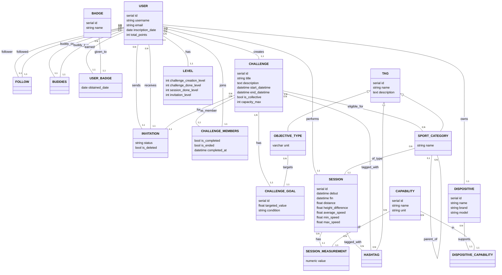

# RunTogether — Rapport de projet (BD6)

*Le réseau social collaboratif pour vos activités sportives*

---

## Sommaire

- [I. Étude du problème](#i-étude-du-problème)
  - [A. Compréhension des demandes et attentes du client](#a-compréhension-des-demandes-et-attentes-du-client)
  - [B. Élaboration d'un diagramme entité/relation](#b-élaboration-dun-diagramme-entitérelation)
  - [C. Mise en évidence des contraintes externes](#c-mise-en-évidence-des-contraintes-externes)
- [II. Architecture](#ii-architecture)
  - [A. Scripts d'initialisation](#a-scripts-dinitialisation)
  - [B. Tables et contraintes](#b-tables-et-contraintes)
  - [C. Indexages](#c-indexages)
  - [D. Triggers et fonctions](#d-triggers-et-fonctions)
  - [E. Peuplage des tables et seed](#e-peuplage-des-tables-et-seed)
  - [F. Requêtes](#f-requêtes)
- [III. RLS](#iii-rls)
- [IV. Vers un algorithme de recommandation](#iv-vers-un-algorithme-de-recommandation)
- [V. Discussion](#v-discussion)

---

# I. Étude du problème

## A. Compréhension des demandes et attentes du client

RunTogether est une application collaborative centrée sur les activités sportives d'endurance
(course à pied, vélo, randonnée, natation, kayak…). Avant toute modélisation, nous avons dégagé
les grands besoins fonctionnels exprimés par le cahier des charges :

- **Enregistrer des séances sportives**, avec un socle minimal de mesures (horaires, distance,
  dénivelé positif, vitesse moyenne et maximale) et des mesures supplémentaires facultatives
  selon le dispositif utilisé (fréquence cardiaque, calories, cadence, température…).
- **Gérer des défis** créés par les utilisateurs, limités dans le temps, rattachés à une ou
  plusieurs catégories sportives, et porteurs d'un objectif précis (distance, dénivelé, temps ou
  nombre de jours actifs). Les défis sont soit **individuels**, soit **collectifs** (avec une
  capacité maximale de participants).
- **Comptabiliser automatiquement** les séances éligibles à un défi en cours.
- **Modéliser le volet social** : suivre d'autres comptes (relation orientée et non
  nécessairement symétrique), devenir *buddies* lorsque le suivi est réciproque, et inviter ses
  buddies à des défis.
- **Catégoriser finement** les séances et les défis grâce à des hashtags, et organiser les
  catégories sportives de façon **hiérarchique** (Cyclisme → VTT → Enduro), afin qu'une recherche
  sur une catégorie parente remonte aussi ses sous-catégories.
- **Récompenser l'engagement** via un système de points et de badges.
- **Recommander des défis** adaptés au profil de l'utilisateur (filtrage collaboratif), avec un
  léger biais vers la diversité pour encourager l'exploration.

Ces besoins ont orienté l'ensemble de nos choix de modélisation : nous avons cherché à placer un
maximum de règles métier au niveau de la base (contraintes, triggers), tout en gardant un modèle
suffisamment souple pour évoluer.

## B. Élaboration d'un diagramme entité/relation

### 1. Ensemble de tables

Le modèle s'articule autour d'une entité centrale, `users`, et de plusieurs familles d'entités :

| Famille | Tables |
|---|---|
| Utilisateurs & social | `users`, `followers`, `buddies`, `levels` |
| Récompenses | `badges`, `users_badges` |
| Activité | `sessions`, `session_measurements` |
| Dispositifs | `dispositives`, `capabilities`, `dispositives_capabilities` |
| Défis | `challenges`, `challenges_goals`, `challenge_members`, `invitations` |
| Tags (héritage) | `tags`, `objective_types_tags`, `hashtags_tags`, `sports_categories_tags` |
| Associations tags | `session_hashtags`, `challenge_hashtags`, `challenge_categories` |
| Recommandation | `vectors` (partitionnée en `users_vectors`, `challenges_vectors`) |

### 2. Relations entre les tables

Le diagramme suivant présente le modèle conceptuel. Les cardinalités sont notées à la française
(notation `(min,max)`) à proximité de chaque entité.



Quelques relations méritent un commentaire :

- **`followers` / `buddies`** sont des relations réflexives sur `users`. `followers` est orientée
  (A suit B n'implique pas B suit A) ; `buddies` est symétrique et n'est créée
  qu'automatiquement, lorsqu'un suivi devient réciproque (voir II.D).
- **`SPORT_CATEGORY parent_of SPORT_CATEGORY`** est une relation réflexive qui matérialise la
  hiérarchie des catégories (un nœud a `0,1` parent et `0,N` enfants).
- **L'héritage `TAG <|-- …`** : `objective_types_tags`, `hashtags_tags` et `sports_categories_tags`
  héritent de la table mère `tags` (mécanisme `INHERITS` de PostgreSQL).
- Certaines associations sont portées par des **tables associatives** dédiées (`challenge_members`,
  `invitations`, `session_hashtags`, etc.) qui peuvent transporter leurs propres attributs.

### 3. Colonnes discrètes

Plusieurs colonnes prennent leurs valeurs dans un domaine fini, contrôlé par des contraintes :

- `challenges_goals.condition` ∈ {`greater_than`, `greater_or_equal`, `less_than`,
  `less_or_equal`, `equal`} — verrouillé par un `CHECK`.
- `challenges.is_collective` (booléen) qui conditionne la présence de `capacity_max`.
- `invitations.status` (`sent`, `accepted`, `refused`, `no_reply`) — domaine logique géré au
  niveau applicatif (voir I.C.2).
- `vectors.entity_type` ∈ {`user`, `challenge`} — clé de partitionnement.

À cela s'ajoutent les **colonnes d'audit** présentes sur la plupart des tables (`created_by`,
`updated_by`, `deleted_by`, `created_at`, `updated_at`, `deleted_at`), qui assurent la traçabilité
et la suppression logique (*soft delete*).

## C. Mise en évidence des contraintes externes

Conformément à la consigne, nous avons soigneusement séparé ce qui relève du SGBD de ce qui
relève de l'application.

### 1. Contraintes de base de données

Elles sont garanties directement par PostgreSQL :

- **Clés primaires** (simples et composites) sur toutes les tables (sauf `buddies`, voir limites).
- **Clés étrangères** reliant les entités, avec `ON DELETE CASCADE` là où la suppression doit se
  propager (un défi supprimé entraîne la suppression de ses objectifs, membres et invitations).
- **Contraintes `CHECK`** : valeurs numériques positives (`distance >= 0`…), cohérence des vitesses
  (`min_speed <= avg_speed <= max_speed`), ordre temporel (`start_datetime < end_datetime`),
  cohérence capacité/type de défi, domaine des conditions d'objectif, `tag_depth >= 0`.
- **Contraintes `UNIQUE`** : `users.email`, `tags.name`, et l'unicité d'un objectif par défi
  (`UNIQUE(challenge_id, objective_type_id)`).
- **`DEFAULT`** : `total_points = 0`, `is_collective = FALSE`, horodatages, etc.

### 2. Contraintes d'application

Certaines règles ne sont pas (ou pas raisonnablement) exprimables avec les seuls outils vus en
cours, et relèvent donc de la couche applicative :

- **« Un utilisateur ne peut créer ni participer à plus de trois défis par semaine »** : règle
  temporelle glissante, non triviale à exprimer par une contrainte déclarative.
- **« Le créateur d'un défi est automatiquement participant »** : assuré côté application (et lors
  du peuplage) plutôt que par une contrainte stricte.
- **Capacité d'un défi collectif** : la colonne `capacity_max` est contrôlée, mais l'interdiction
  d'inscrire un participant au-delà de la capacité dépend de l'application.
- **Visibilité par élément du profil** (public / buddies / masqué) : non modélisée dans cette
  version (voir V.A).
- **Domaine de `invitations.status`** : laissé en `VARCHAR` libre, validé applicativement.

Le SGBD garantit ainsi l'intégrité structurelle et les invariants locaux, tandis que l'application
prend en charge les règles transversales et temporelles.

---

# II. Architecture

## A. Scripts d'initialisation

Comme tout projet, la compilation ainsi que l'exécution peuvent s'avérer pénibles selon la
plateforme, la version du langage, les outils et les variables d'environnement. Fort heureusement,
PostgreSQL ne nous impose pas de telles contraintes : à l'exception de la version du langage, il
s'exécute sur toute plateforme (Mac, Windows, Linux) sans souci, car il crée son propre
environnement indépendant.

Nous avons donc appliqué une stratégie commune mais puissante : trois fichiers d'initialisation.

### 1. `setup.sql`

Ce fichier a un but simple : importer l'intégralité des fichiers SQL créant le schéma de la base,
afin que celui-ci y soit implémenté.

Or, lorsque l'on crée une table qui existe déjà, une erreur survient — et les erreurs, on n'aime
pas ça. Les bases de données ont pour but de contenir des… données ; toute modification peut donc
être sensible et impacter leur qualité, leur cohérence, voire leur existence. Il serait fâcheux de
recréer une table existante et de perdre ainsi son contenu. Comment, dès lors, créer ou mettre à
jour son schéma sans tout faire s'effondrer ?

Pour pallier ce problème, SQL offre la clause **`IF NOT EXISTS`**, qui n'exécute la création que
si l'objet n'existe pas déjà. Chaque création de table utilise cette clause : on peut donc importer
`setup.sql` sans la moindre crainte d'écraser des données existantes.

### 2. `reset.sql`

Ce fichier s'oppose au précédent : il n'a pas peur d'avoir un effet destructeur, car c'est là toute
sa raison d'être. `reset.sql` supprime l'intégralité des données et des objets (tables, contraintes,
index, triggers, fonctions — soit tout ce qui est décrit en II.B à II.F).

Pour cela, nous supprimons simplement le schéma puis le recréons : on évite ainsi une suppression au
cas par cas. Ce script ne sert qu'à repartir d'une base vierge pour les tests ; il est inutilisable
en conditions réelles, avec de vraies données.

### 3. `test_data.sql`

Afin de garantir le bon fonctionnement global, nous avons mis en place un ensemble de scripts de
test intégrés au projet. L'objectif est de valider rapidement et de manière reproductible que les
contraintes, relations et comportements attendus fonctionnent correctement.

Ces scripts reposent sur l'injection de données fictives (*mock data* / *seed*) : utilisateurs,
défis, séances et relations diverses simulant un usage réel. L'idée n'est pas de produire des
données réalistes de production, mais de couvrir un maximum de cas d'usage. Elles permettent de
vérifier :

- le respect des contraintes d'intégrité (clés primaires, étrangères, unicité…) ;
- le comportement des relations dans les cas normaux et limites ;
- le bon fonctionnement des requêtes complexes ;
- la cohérence globale du schéma après insertion et suppression.

En pratique, ces scripts s'exécutent après `setup.sql` et peuvent être réinitialisés à volonté via
`reset.sql`, ce qui permet de reconstruire un environnement de test propre et identique à chaque
exécution — précieux pour le débogage et la validation des évolutions du schéma.

## B. Tables et contraintes

La structure repose sur un ensemble de tables fortement normalisées, chacune ayant un rôle précis.
L'objectif est de garantir cohérence, intégrité et flexibilité.

**Une modélisation centrée sur les entités principales.** La table `users` constitue le cœur du
système : elle stocke l'identité, l'email et les points, et intègre une traçabilité via
`created_by`, `updated_by`, `deleted_by` — renforcés par des clés étrangères auto-référencées vers
`users`. Autour d'elle s'articulent les tables de relation sociale : `followers` (relation orientée)
et `buddies` (relation symétrique), qui utilisent des clés composites pour éviter les doublons.

**Progression : badges, sessions.** Les `badges` récompensent les actions ; les `sessions`
enregistrent les performances physiques. Dans `sessions`, plusieurs `CHECK` garantissent la
cohérence des valeurs (aucune valeur négative, `min_speed <= avg_speed <= max_speed`, ordre
temporel début/fin), prévenant toute insertion incohérente dès la base.

**Défis et logique métier.** Les tables `challenges`, `challenge_members`, `challenges_goals` et
leurs tables associatives (hashtags, catégories, invitations) représentent un système complet de
défis collaboratifs ou individuels. `challenges` intègre des contraintes conditionnelles
importantes (cohérence des dates, logique de capacité dépendant de `is_collective`), imposant des
règles métier directement au niveau de la base. Les objectifs sont sécurisés par des contraintes
d'unicité et de validation sur les conditions (`greater_than`, `less_or_equal`…).

**Typologie et héritage de tags.** Une table mère `tags` est étendue par `objective_types_tags`,
`hashtags_tags` et `sports_categories_tags` grâce à l'héritage PostgreSQL. Ce choix factorise les
champs communs tout en spécialisant certains comportements (profondeur hiérarchique des catégories,
contrôlée par `tag_depth >= 0`).

**Intégrité et relations fortes.** L'ensemble est encadré par des clés étrangères et des règles
`ON DELETE CASCADE`, garantissant une suppression propre des données liées. Les tables de jointure
(`session_hashtags`, `challenge_hashtags`, `challenge_categories`, `dispositives_capabilities`)
représentent des relations *many-to-many* avec unicité assurée par clé composite.

**Dispositifs et mesures.** `dispositives`, `capabilities` et `session_measurements` modélisent les
objets connectés et leurs données. Cette architecture flexible associe dynamiquement des capacités
(fréquence cardiaque, cadence, température…) aux séances, sans figer le schéma.

**Une base robuste et fortement contrainte.** Enfin, la table `vectors`, partitionnée par type
d'entité, illustre une approche plus avancée : le partitionnement optimise les performances tout en
conservant une logique de stockage unifiée. Globalement, le schéma s'appuie fortement sur les
contraintes SQL (`CHECK`, `UNIQUE`, `FOREIGN KEY`, `DEFAULT`) pour déplacer une part importante de
la logique métier dans la base, améliorant robustesse et cohérence sur le long terme.

## C. Indexages

Les index accélèrent les lectures (`SELECT`) en évitant les parcours complets de table (*full table
scan*), coûteux dès que le volume croît.

Dans ce projet, les index sont **partiels** : ils ne s'appliquent qu'au sous-ensemble
`deleted_at IS NULL`, c'est-à-dire aux enregistrements actifs. Cette approche est parfaitement
adaptée à notre logique de suppression logique (*soft delete*) : les données ne sont pas
physiquement supprimées, mais marquées inactives.

- `idx_users_not_deleted` accélère les requêtes sur les utilisateurs actifs (la majorité des cas
  d'usage), sans parcourir les lignes supprimées.
- `idx_followers_not_deleted` et `idx_buddies_not_deleted` (index composés sur les identifiants)
  optimisent la navigation sociale, susceptible de générer un grand nombre de relations.

Ces index réduisent significativement le coût des lectures pertinentes tout en restant cohérents
avec la suppression logique : un bon compromis entre performance et intégrité fonctionnelle.

## D. Triggers et fonctions

Les triggers et fonctions constituent une couche de logique métier directement intégrée à la base.
Ils automatisent certains comportements, garantissent la cohérence et déclenchent des actions sans
intervention applicative.

**Automatisation des créations liées.** Lors de l'insertion d'un utilisateur ou d'un défi,
`add_vectors_on_new_user()` et `add_vectors_on_new_challenge()` préparent automatiquement les
vecteurs de recommandation associés (voir IV). De même, la création d'une catégorie sportive
déclenche `add_vector_on_new_sport_category()`, qui ajoute la nouvelle dimension à toutes les
entités existantes.

**Gestion des relations sociales.** Le trigger `move_to_buddies_if_reciprocal_followers()` illustre
une logique plus avancée : lorsqu'un suivi devient réciproque, la relation est automatiquement
transformée en relation *buddies*. Les suppressions logiques sont prises en compte pour éviter
doublons et incohérences.

**Hiérarchie des catégories.** `set_depth()` calcule automatiquement la profondeur d'une catégorie
sportive en fonction de son parent, lors d'une insertion ou d'une mise à jour. La base devient ainsi
responsable de la structure de l'arbre, sans gestion manuelle côté application.

**Complétion des défis.** `check_challenges_completion()` est l'une des logiques les plus complexes.
Déclenchée à chaque nouvelle séance, elle parcourt les défis actifs de l'utilisateur, évalue les
objectifs de chacun (en comparant les performances cumulées aux conditions attendues) et met à jour
l'état du défi lorsqu'il est complété — assurant une évaluation en temps réel sans intervention
applicative.

Globalement, ces mécanismes centralisent une part importante de la logique métier dans la base,
garantissant une exécution automatique, cohérente et immédiate, indépendamment du client.

## E. Peuplage des tables et seed

Le peuplage insère des données afin de rendre la base exploitable et testable. Il repose sur des
blocs `DO $$ ... $$` (boucles, tirages pseudo-aléatoires) et des insertions classiques, générant un
volume important de données cohérentes. On distingue plusieurs niveaux :

**Le seed minimal** — le strict nécessaire au fonctionnement : types d'objectifs, hashtags
principaux, catégories sportives, badges fondamentaux. Stable, peu volumineux et déterministe, il
sert de socle ; sans lui, certaines contraintes ou relations ne pourraient être satisfaites.

**Le seed fonctionnel enrichi** — il représente un environnement réaliste : hiérarchies de
catégories, capabilities, niveaux utilisateurs. Il ne se contente plus de faire fonctionner la base,
il simule un véritable écosystème.

**Le peuplage de test** — dynamique et aléatoire, il génère un grand volume (séances, défis,
relations sociales, invitations) via boucles et tirages. Il permet de tester les performances sous
charge, le bon fonctionnement des relations complexes, et la validation des triggers en conditions
proches du réel.

**Différence entre seed et peuplage.** Le seed est minimal, stable et nécessaire (la fondation) ;
le peuplage est massif, dynamique et souvent aléatoire (la mise en situation). En résumé, le seed
permet à la base de « démarrer », le peuplage permet de la « mettre en situation » et de la valider.

> **Note sur la consigne CSV.** La consigne suggère l'import par fichiers CSV (`COPY` + tables
> temporaires + `ALTER TABLE … DROP COLUMN`). Nous avons préféré la voie également autorisée des
> structures de contrôle intégrées (`DO $$ … $$`, `generate_series`, `random()`), qui produit des
> données plus variées et reproductibles tout en évitant la maintenance de fichiers externes.

## F. Requêtes

Cette partie démontre la capacité du schéma à répondre à des problématiques variées, des simples
agrégations aux requêtes avancées (sous-requêtes, jointures complexes, fonctions analytiques,
récursivité). Au total, le projet implémente plus de vingt requêtes, couvrant l'ensemble des cas
imposés.

**Relations et agrégations.** Le calcul de statistiques utilisateur (distance totale, nombre de
séances, vitesses moyennes) repose sur des jointures et des agrégations (`AVG`, `COUNT`, `SUM`). Le
classement par « XP » ou le comptage de séances par utilisateur exploitent des jointures externes
(`LEFT JOIN`) et des agrégats pour produire des vues globales.

**Sous-requêtes et logique conditionnelle.** Plusieurs requêtes utilisent des sous-requêtes
corrélées ou non. La sélection des utilisateurs ayant effectué au moins une séance repose sur
`EXISTS`. Les conditions de **totalité** (utilisateurs dont *toutes* les séances dépassent une
distance) sont exprimées de deux façons équivalentes : `NOT EXISTS` corrélé d'une part, agrégation
avec `HAVING` d'autre part.

**Cas des valeurs `NULL`.** Le projet met en évidence la sensibilité aux `NULL` : la différence
entre `NOT IN` et `NOT EXISTS` lorsqu'une colonne (ici `deleted_by`) contient des valeurs nulles. La
version `NOT IN` renvoie un résultat vide, tandis que `NOT EXISTS` renvoie le résultat attendu ; on
propose alors une petite modification (`… WHERE deleted_by IS NOT NULL`) pour réconcilier les deux.

**Récursivité et fenêtrage.** Les requêtes récursives parcourent des structures de graphe : chemin
entre utilisateurs via la relation *buddy*, ou descendants d'une catégorie sportive (afin qu'une
recherche `#Cyclisme` remonte `#VTT` et `#Enduro`). Les fonctions de fenêtrage (`ROW_NUMBER() OVER
(PARTITION BY …)`) produisent des classements internes, comme le top 3 des séances les plus longues
par utilisateur sur 90 jours.

**Requêtes analytiques.** Enfin, certaines requêtes produisent des indicateurs de tableau de bord
(défis les plus populaires, utilisateurs les mieux classés) en combinant jointures, filtres
temporels et agrégations.

L'ensemble couvre un large spectre de fonctionnalités SQL tout en restant cohérent avec les
contraintes du modèle, confirmant que la base est non seulement bien modélisée mais aussi capable
de supporter des analyses complexes.

---

# III. RLS

## A. Sur quoi et pourquoi ?

La *Row Level Security* (RLS) est un mécanisme de PostgreSQL permettant de contrôler l'accès aux
données au niveau des **lignes** d'une table, plutôt qu'au niveau global de la table.

Dans ce projet, elle est définie sur la majorité des tables via des politiques du type :

```sql
USING (deleted_at IS NULL)
WITH CHECK (deleted_at IS NULL)
```

L'objectif est de garantir que les données marquées comme supprimées (*soft delete*) ne soient
jamais visibles ni modifiables par les requêtes applicatives classiques, renforçant la cohérence du
modèle de suppression logique. Certaines tables (`challenge_members`, `capabilities`, `levels`,
`challenges_goals`, `dispositives_capabilities`) utilisent une politique plus permissive
(`USING (TRUE)`), car elles ne nécessitent pas de filtrage — ce sont des données de référence ou de
liaison.

Enfin, un rôle dédié `admin_user` est créé avec le droit `BYPASSRLS`, offrant un accès complet,
indépendamment des politiques, pour l'administration et la maintenance.

## B. Avantages et inconvénients

**Avantages :**

- **Sécurité renforcée** : les règles d'accès sont centralisées dans la base, et non dépendantes
  de la seule couche applicative.
- **Cohérence globale** : le filtre `deleted_at IS NULL` s'applique automatiquement, quelle que
  soit la requête.
- **Réduction des erreurs applicatives** : on limite le risque d'oublier un filtre côté client.
- **Isolation logique** : chaque ligne peut être conditionnée selon des règles précises.

**Inconvénients :**

- **Complexité accrue** : la logique d'accès devient moins visible depuis l'application.
- **Débogage plus difficile** : une requête peut ne rien renvoyer sans cause immédiatement
  évidente.
- **Coût en performance potentiel** : les politiques sont évaluées à chaque requête.
- **Risque de mauvaise configuration** : une politique mal définie peut bloquer ou exposer des
  données involontairement.

## C. Pallier aux inconvénients

Plusieurs bonnes pratiques sont mises en place :

- **Standardisation** : la majorité des tables utilisent la même logique (`deleted_at IS NULL`),
  ce qui réduit les erreurs et facilite la maintenance.
- **Rôle `admin_user` avec `BYPASSRLS`** : conserve une capacité de debug et de maintenance
  complète.
- **Séparation claire des types de tables** : RLS strict pour les tables sensibles, politiques
  permissives pour les tables de référence.
- **Tests via seed et requêtes dédiées** : les données générées permettent de vérifier que les
  politiques ne bloquent pas de flux fonctionnels de manière inattendue.

---

# IV. Vers un algorithme de recommandation

## A. Idée

Nous nous sommes inspirés des techniques de **filtrage collaboratif** et du **modèle vectoriel**
(*vector space model*). L'idée : représenter chaque utilisateur et chaque défi comme un **vecteur**
dont les dimensions sont les **catégories sportives**. Si le vecteur d'un défi pointe dans la même
direction que celui de l'utilisateur, c'est que le défi correspond à ses goûts.

On mesure cette proximité par l'**angle** entre les deux vecteurs (similarité cosinus). Cela donne
naturellement deux modes de recommandation :

- **« Similaire »** — les défis dont l'angle avec le profil est le plus petit (goûts proches) ;
- **« Découverte »** — les défis dont l'angle est le plus grand (goûts opposés), pour favoriser
  l'exploration de nouveaux formats, conformément au « léger biais vers la diversité » de la
  consigne.

## B. Fonctionnement

Le calcul se déroule en plusieurs étapes.

**1. Valeurs brutes.** Le vecteur d'un utilisateur reçoit, pour chaque catégorie, le nombre de
défis (auxquels il participe) éligibles à cette catégorie. Le vecteur d'un défi reçoit `1` pour
chacune de ses catégories éligibles, `0` ailleurs.

**2. Normalisation (`calculate_vector_softmax`).** Les valeurs brutes ne sont pas directement
comparables (un utilisateur très actif écraserait les autres). On applique donc, par entité :

- un **softmax** `2 · (eᵛ / Σ eᵛ) − 1` qui transforme les valeurs en proportions, puis les ramène
  dans l'intervalle `[-1, 1]` ;
- un **centrage** (soustraction de la moyenne) qui donne au vecteur une vraie composante positive
  *et* négative ;
- une **normalisation L2** (division par la norme) qui ramène chaque vecteur à une longueur de 1.

Après cette étape, tous les vecteurs sont de norme 1 et centrés : seule leur **direction** (le goût)
subsiste, indépendamment du niveau d'activité.

**3. Comparaison.** Pour deux vecteurs de norme 1, le **produit scalaire** vaut directement le
**cosinus de l'angle** :

- cosinus proche de `+1` → goûts quasi identiques (à recommander) ;
- cosinus proche de `0` → sans rapport ;
- cosinus proche de `−1` → goûts opposés (à proposer en « découverte »).

On en déduit l'**angle** (`arccos`) et l'on calcule également la **distance euclidienne**, plus
intuitive.

## C. Implémentation

**Stockage.** La table `vectors` stocke les vecteurs en format « long » (une ligne par
`entity_type`, `entity_id`, `category_id`, `value`). Ce choix permet d'ajouter de nouvelles
catégories sans modifier le schéma (pas d'`ALTER TABLE`). Elle est **partitionnée par liste** sur
`entity_type` en `users_vectors` et `challenges_vectors`, ce qui accélère les lectures.

**Initialisation.** Des triggers créent automatiquement les lignes (à `0`) lors de la création d'un
utilisateur, d'un défi ou d'une catégorie. Un script de calcul (`04_compute_vectors.sql`) remplit
ensuite les valeurs brutes, puis appelle `calculate_vector_softmax` pour chaque entité non nulle.

**Requêtes.** Deux requêtes préparées exposent l'indice de recommandation, et renvoient les `n`
meilleurs défis à venir pour un utilisateur donné :

```sql
-- défis les plus proches du profil
EXECUTE recommend_similar(:user_id, :n);

-- défis les plus éloignés (découverte)
EXECUTE recommend_discover(:user_id, :n);
```

Chacune calcule, pour tout défi à venir, le **cosinus**, l'**angle (en degrés)** et la **distance**,
exclut les défis auxquels l'utilisateur participe déjà, écarte les vecteurs nuls
(`NULLIF` sur la norme), puis trie par cosinus décroissant (`recommend_similar`) ou croissant
(`recommend_discover`). L'indice de recommandation est donc le cosinus de similarité, calculé à la
demande pour un couple (utilisateur, défi).

---

# V. Discussion

## A. Limites du projet

- **RLS non activée.** Les politiques sont définies mais `ROW LEVEL SECURITY` n'est pas explicitement
  activée sur les tables (`ALTER TABLE … ENABLE ROW LEVEL SECURITY`) ; les politiques ne sont donc
  pas encore appliquées. C'est une amélioration immédiate à apporter.
- **Visibilité du profil** (public / buddies / masqué) non modélisée.
- **Règles temporelles** non implémentées au niveau SGBD : limite de trois défis par semaine,
  créateur automatiquement participant, capacité maximale réellement bloquante.
- **Catégorie des séances** : les séances ne sont pas directement reliées à une catégorie sportive ;
  l'affinité utilisateur est dérivée des catégories des défis rejoints.
- **Hiérarchie et recommandation** : le vecteur d'un défi ne propage pas (encore) l'appartenance le
  long de la hiérarchie des catégories (un défi « VTT » ne contribue pas automatiquement à
  « Cyclisme »).
- **Démarrage à froid** (*cold start*) : un utilisateur sans activité a un vecteur nul et ne peut
  pas recevoir de recommandation pertinente.
- **`buddies` sans clé primaire** : l'unicité de la paire n'est pas garantie structurellement.

## B. Points forts du projet

- **Logique métier dans la base** : contraintes riches (`CHECK`, `UNIQUE`, FK, cascades) et triggers
  qui garantissent la cohérence indépendamment du client.
- **Système de recommandation original** fondé sur un modèle vectoriel, avec deux modes
  complémentaires (similarité et découverte).
- **Conception extensible** : héritage de tags, table `vectors` générique en format long,
  partitionnement, modèle dispositif/capacité/mesure flexible.
- **Suppression logique** systématique couplée à des index partiels, préservant l'historique tout
  en gardant des lectures rapides.
- **Reproductibilité** : scripts d'initialisation et de peuplage permettant de reconstruire la base
  à l'identique.

## C. Modularité et évolution dans le temps

Le modèle a été pensé pour évoluer sans réécriture lourde :

- `IF NOT EXISTS` rend l'initialisation idempotente et tolérante aux mises à jour incrémentales.
- La table `vectors` en format long absorbe l'ajout de nouvelles catégories (donc de nouvelles
  dimensions de recommandation) sans modification de schéma.
- L'héritage de `tags` permet d'ajouter de nouveaux types de tags en factorisant le commun.
- Le triplet `dispositives` / `capabilities` / `session_measurements` accueille de nouvelles mesures
  (puissance, SpO₂…) sans toucher à la table `sessions`.
- Le partitionnement de `vectors` prépare la montée en charge.

Les évolutions futures naturelles incluent : l'activation effective de la RLS, la modélisation de la
visibilité du profil, la prise en compte de la hiérarchie dans les vecteurs, et l'enrichissement de
l'indice de recommandation par des signaux sociaux (défis complétés par les *buddies*) et de
progression (moyennes mensuelles), comme suggéré par la consigne.
